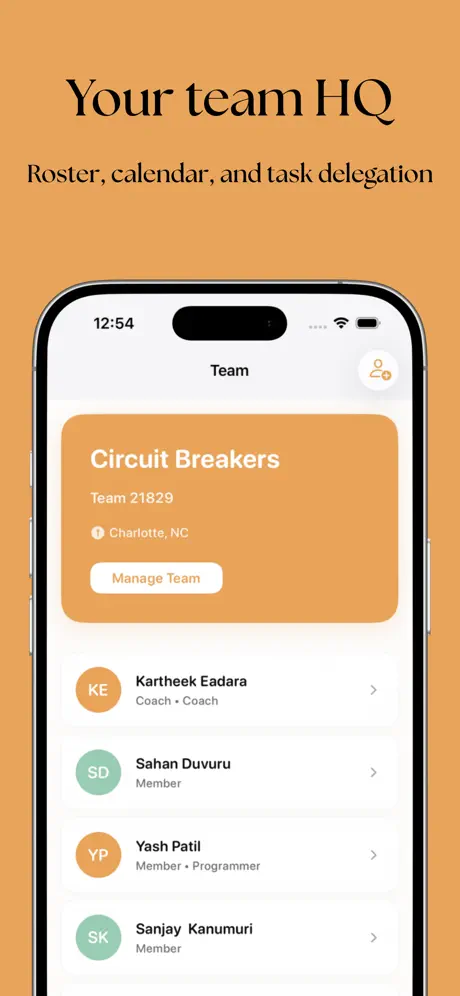
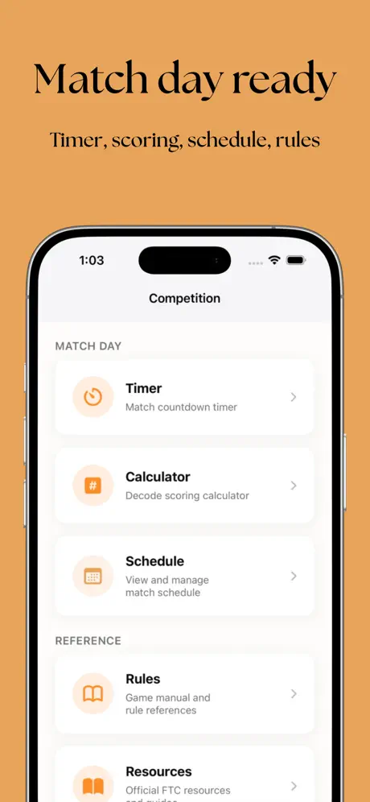
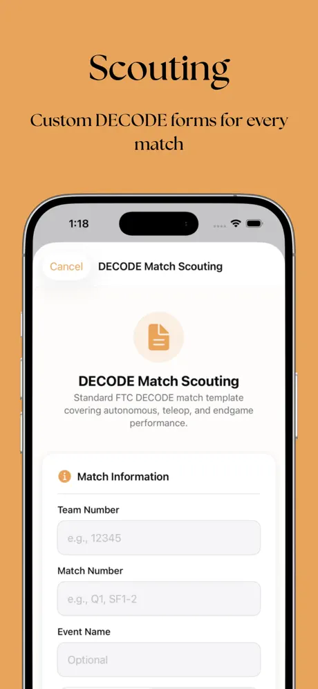
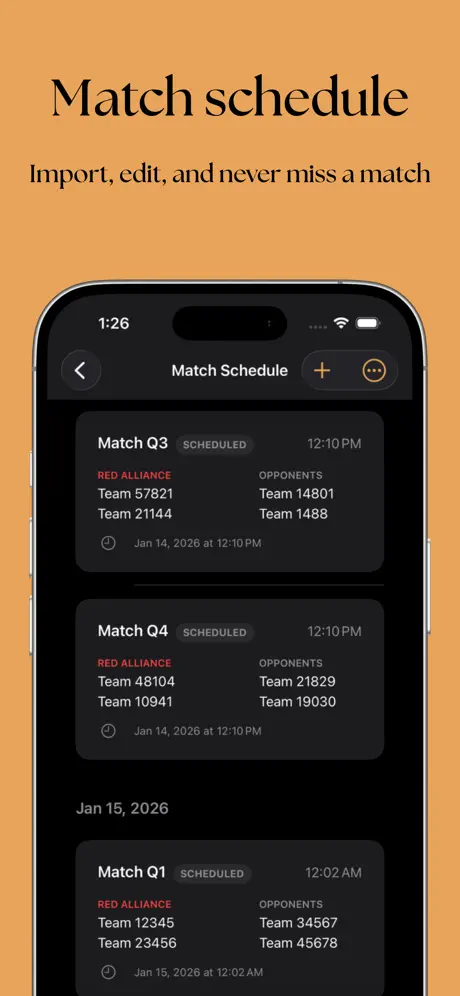
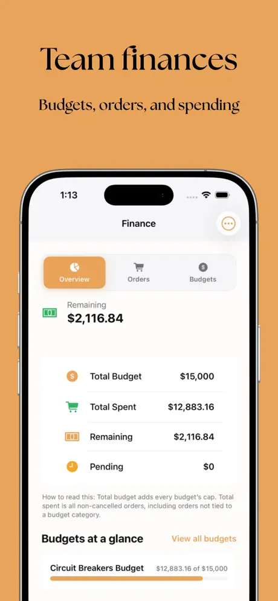
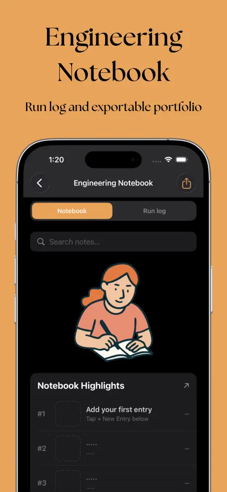

# FTCHUB

Native iOS application for [FIRST Tech Challenge](https://www.firstinspires.org/robotics/ftc) teams. FTCHUB combines team operations, competition tooling, finance tracking, scouting workflows, and educational resources in a single SwiftUI client backed by Supabase.

FTCHUB is an independent project and is not affiliated with or endorsed by FIRST.

**[Download on the App Store](https://apps.apple.com/us/app/ftc-hub/id6755899343)**

<p align="center">






</p>

## Highlights

- Production-oriented SwiftUI app with role-aware navigation (guest, authenticated, and full team modes)
- Supabase backend with Postgres, row-level security, storage, and Edge Functions
- Multi-provider authentication: email, Google Sign-In, Sign in with Apple, and guest access
- Offline-capable resources, sync, and local caching for competition-day use
- Security-focused setup: secret scanning in CI, client/server secret separation, rate limiting

## Features

| Area | Capabilities |
|------|--------------|
| **Team** | Create or join via invite code, member roles, join requests, events, tasks, availability |
| **Finance** | Budgets, purchase orders, vendors, receipts, spending analytics, export |
| **Tools** | Scouting templates and reports, pit scouting, engineering notebook, team explorer |
| **Competition** | Match schedule, drive team timer, scoring calculator, rules reference, schedule OCR import |
| **Resources** | Learning modules, flashcards, FTC reference material, offline downloads |
| **Strategy** | Alliance compatibility, picklists, FTC Scout and Orange Alliance integrations |
| **Platform** | Push notifications, legal consent flows, content moderation, account deletion |

## Architecture

```
FTCHUBApp
  ├── AuthService, TelemetryService, ResourcesService
  ├── Deep link routing (ftchub://)
  └── ContentView
        ├── Authentication and onboarding
        └── MainTabView
              ├── TeamService, FinanceService, ScoutingService, ScheduleService
              └── Feature views (Finance, Tools, Competition, Settings)
```

**Client:** SwiftUI views and view models under `FTCHUB/`, with a service layer for Supabase, external APIs, and local persistence.

**Backend:** Supabase Auth, Postgres with RLS policies, Storage buckets, and Edge Functions in `supabase/functions/` (`delete-auth-user`, `serve-verification-page`).

**Web assets:** Static HTML for email verification and password reset flows in `web/`.

## Tech stack

| Layer | Technology |
|-------|------------|
| UI | SwiftUI, iOS 17+ |
| Backend | Supabase (Auth, PostgREST, Realtime, Storage, Edge Functions) |
| Dependencies | [supabase-swift](https://github.com/supabase/supabase-swift), [GoogleSignIn-iOS](https://github.com/google/GoogleSignIn-iOS), [Kingfisher](https://github.com/onevcat/Kingfisher) |
| External data | FTC Scout API, Orange Alliance API, optional parts catalog manifest |
| Tooling | Supabase CLI, GitHub Actions (gitleaks secret scan) |

## Requirements

- macOS with Xcode 16 or later
- iOS 17.0 deployment target
- A Supabase project (URL and anon key)
- Optional: Google OAuth client IDs for Google Sign-In

## Getting started

### 1. Clone and open the project

```bash
git clone <repository-url>
cd FTCHUB
open FTCHUB.xcodeproj
```

### 2. Configure secrets

Copy the sample configuration and fill in your project values:

```bash
cp FTCHUB/Resources/Secrets.sample.plist FTCHUB/Resources/Secrets.plist
cp FTCHUB/Config/Secrets.xcconfig.example FTCHUB/Config/Secrets.xcconfig
```

Required keys in `Secrets.plist`:

| Key | Description |
|-----|-------------|
| `SUPABASE_URL` | Supabase project URL |
| `SUPABASE_ANON_KEY` | Supabase anon (public) key |
| `SUPABASE_EMAIL_REDIRECT_URL` | Deep link for auth callbacks (default: `ftchub://auth-callback`) |
| `GOOGLE_IOS_CLIENT_ID` | Google OAuth iOS client ID |
| `GOOGLE_WEB_CLIENT_ID` | Google OAuth web client ID (required for Supabase Google provider) |

Never commit `Secrets.plist`, `Secrets.xcconfig`, or service role keys. See [SECURITY.md](SECURITY.md).

### 3. Apply database migrations

Use the Supabase CLI or SQL editor to apply migrations in `supabase/migrations/`. Reference scripts from earlier development are archived in `docs/database/archive/`.

```bash
npm install   # installs Supabase CLI as a dev dependency
npx supabase db push
```

### 4. Deploy Edge Functions (optional)

```bash
export SUPABASE_PROJECT_REF="your-project-ref"
export SUPABASE_URL="https://your-project-ref.supabase.co"
export SUPABASE_SERVICE_ROLE_KEY="your-service-role-key"
./deploy-edge-function.sh
```

See `deploy-edge-function.sh.example` for the required environment variables.

### 5. Build and run

Select the FTCHUB scheme in Xcode and run on a simulator or device. Guest mode allows exploring Resources, Calculator, and Timer without signing in.

## Project structure

```
FTCHUB/
├── FTCHUB/                 # iOS application source
│   ├── Models/             # Domain models
│   ├── Services/           # API, sync, and business logic
│   ├── Views/              # SwiftUI screens and components
│   ├── Utils/              # Design system, config, helpers
│   └── Resources/Legal/    # In-app privacy policy and terms
├── supabase/               # Migrations and Edge Functions
├── web/                    # Hosted auth and support pages
├── docs/                   # Operational documentation
├── Scripts/                # Build and catalog tooling
├── SECURITY.md             # Secret handling and security practices
└── README.md
```

## Security

- Client bundles only the Supabase anon key; RLS enforces data access on the server.
- Service role keys and third-party tokens belong in CI or Edge Function secrets only.
- CI runs [gitleaks](.github/workflows/gitleaks.yml) on push and pull requests.

Full details: [SECURITY.md](SECURITY.md).

## Documentation

- [SECURITY.md](SECURITY.md) — secret handling, migrations, rate limiting
- [docs/PARTS_CATALOG_ETL.md](docs/PARTS_CATALOG_ETL.md) — building a remote parts catalog manifest
- [docs/database/archive/](docs/database/archive/) — historical SQL reference scripts

## License

Copyright (c) Kartheek Eadara. All rights reserved.

FIRST, FIRST Tech Challenge, and FTC are trademarks of FIRST, which does not sponsor, endorse, or authorize this project.
